<picture>
  <source media="(max-width: 760px)" srcset="./assets/generated/hero-mobile.svg">
  
</picture>

Estudio Análisis y Desarrollo de Software en el SENA y desarrollo proyectos full stack en Riwi. Me interesan la ciberseguridad defensiva, la inteligencia artificial, la automatización, la arquitectura de software y el cloud computing.

[Actividad](#actividad-en-github) · [Tecnologías](#tecnologías-y-lenguajes) · [Proyectos](#proyectos-destacados) · [Contacto](#contacto)

## Actividad en GitHub

<!-- activity:start -->

<picture>
  <source media="(max-width: 760px)" srcset="./assets/generated/stats-mobile.svg">
  
</picture>

<picture>
  <source media="(max-width: 760px)" srcset="./assets/generated/contributions-mobile.svg">
  
</picture>

Actividad pública reciente

- 2026-11-19 UTC · Envío de cambios ×3 · [levets01/levets01](https://github.com/levets01/levets01)

<!-- activity:end -->

## Tecnologías y lenguajes

<!-- stack:start -->

<picture>
  <source media="(max-width: 760px)" srcset="./assets/generated/skills-mobile.svg">
  
</picture>

<!-- stack:end -->

## Proyectos destacados

<!-- projects:start -->

<a href="https://github.com/levets01/Turno_Office">
<picture>
  <source media="(max-width: 760px)" srcset="./assets/generated/project-turno-office-mobile.svg">
  
</picture>
</a>

<a href="https://github.com/levets01/backeng_node">
<picture>
  <source media="(max-width: 760px)" srcset="./assets/generated/project-backeng-node-mobile.svg">
  
</picture>
</a>

<a href="https://github.com/levets01/SALES-CONTROL_Riwi">
<picture>
  <source media="(max-width: 760px)" srcset="./assets/generated/project-sales-control-riwi-mobile.svg">
  
</picture>
</a>

<a href="https://github.com/levets01/CONTROL_IVENTARIO-RIWI">
<picture>
  <source media="(max-width: 760px)" srcset="./assets/generated/project-control-iventario-riwi-mobile.svg">
  
</picture>
</a>

<!-- projects:end -->

[Ver todos los repositorios públicos](https://github.com/levets01?tab=repositories)

## Contacto

[GitHub](https://github.com/levets01) · [steveniglesias@gmail.com](mailto:steveniglesias@gmail.com) · [Ver el retrato estático](./assets/generated/portrait-static.svg)
