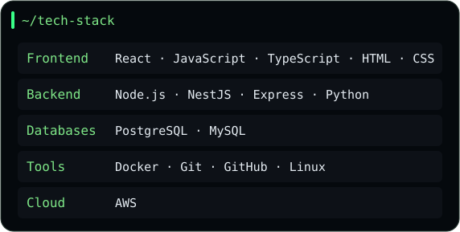

\<!-- dashboard\:start -->

\<div align="center">

# STEVEL IGLESIAS

**Junior Software Developer · Full Stack Development · Cybersecurity**

Tecnólogo en formación en Análisis y Desarrollo de Software — **SENA**
**Coder en Riwi** · Colombia 🇨🇴

\


\</div>

---

\<!-- HERO ANIMADO -->

\<picture>
&#x20; \<source media="(max-width: 760px)" srcset="./assets/generated/hero-mobile.svg">
&#x20; \
\</picture>

---

### `> github.stats --user levets01`

\<picture>   \<source media="(max-width: 760px)" srcset="./assets/generated/stats-mobile.svg">   \ \</picture>

### `> git log --contributions`

\<picture>
&#x20; \<source media="(max-width: 760px)" srcset="./assets/generated/contributions-mobile.svg">
&#x20; \
\</picture>

---

### `> cat tech-stack.json`

\<picture>   \<source media="(max-width: 760px)" srcset="./assets/generated/skills-mobile.svg">   \ \</picture>

---

### `> ls ./featured-projects`

\<table> \<tr> \<td width="100%">

\<a href="[https://github.com/levets01/backeng_node](https://github.com/levets01/backeng_node)"> \<picture>   \<source media="(max-width: 760px)" srcset="./assets/generated/project-backeng-node-mobile.svg">   \ \</picture> \</a>

\</td> \</tr> \<tr> \<td>

\<a href="[https://github.com/levets01/CONTROL_IVENTARIO-RIWI](https://github.com/levets01/CONTROL_IVENTARIO-RIWI)"> \<picture>   \<source media="(max-width: 760px)" srcset="./assets/generated/project-control-iventario-riwi-mobile.svg">   \ \</picture> \</a>

\</td> \</tr> \<tr> \<td>

\<a href="[https://github.com/levets01/SALES-CONTROL_Riwi](https://github.com/levets01/SALES-CONTROL_Riwi)">
\<picture>
&#x20; \<source media="(max-width: 760px)" srcset="./assets/generated/project-sales-control-riwi-mobile.svg">
&#x20; \
\</picture>
\</a>

\</td> \</tr> \</table>

\<div align="center">

[**Explorar todos mis repositorios**](https://github.com/levets01?tab=repositories)

\</div>

---

### `> cat about-me.md`

```text
$ whoami

Name       : Stevel Iglesias
Role       : Junior Software Developer
Education  : SENA — ADSO (en formación)
Community  : Riwi — Coder
Location   : Colombia

$ cat interests.txt

[+] Full Stack Development
[+] Defensive Cybersecurity
[+] Artificial Intelligence
[+] Software Architecture
[+] Cloud Computing
[+] Automation
```

Actualmente me encuentro fortaleciendo mis habilidades en desarrollo de software, construyendo soluciones que integran frontend, backend, bases de datos y herramientas de automatización.

Me interesa especialmente desarrollar sistemas seguros, escalables y orientados a resolver problemas reales.

---

### `> git log --recent`

\<details>
\<summary>\<strong>Ver actividad pública reciente\</strong>\</summary>

- 2026-11-17 UTC · Push · [Turno_Office](https://github.com/levets01/Turno_Office)
- 2026-11-17 UTC · Push · [Turno_Office](https://github.com/levets01/Turno_Office)
- 2026-11-17 UTC · Create · [Turno_Office](https://github.com/levets01/Turno_Office)

\</details>

---

\<div align="center">

### `> ./connect.sh`

**¿Tienes un proyecto interesante o quieres colaborar?**

\


`Code · Learn · Build · Improve`

\</div>

\<!-- dashboard\:end -->
