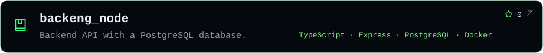

<!-- dashboard:start -->

# STEVEL IGLESIAS

**Junior Software Developer | Full Stack | Cybersecurity**

Tecnólogo en formación en Análisis y Desarrollo de Software — **SENA**

**Riwi Coder** · Colombia 🇨🇴

<picture>
  <source media="(max-width: 760px)" srcset="./assets/generated/hero-mobile.svg">
  
</picture>

### `> github.stats --user levets01`

<picture>
  <source media="(max-width: 760px)" srcset="./assets/generated/stats-mobile.svg">
  
</picture>

### `> git log --contributions`

<picture>
  <source media="(max-width: 760px)" srcset="./assets/generated/contributions-mobile.svg">
  
</picture>

### `> cat tech-stack.json`

<picture>
  <source media="(max-width: 760px)" srcset="./assets/generated/skills-mobile.svg">
  
</picture>

### `> ls ./featured-projects`

### `> ./connect.sh`

[GitHub](https://github.com/levets01) · [Contacto](mailto:steveniglesias@gmail.com)

<!-- dashboard:end -->
