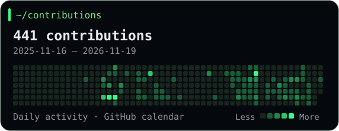
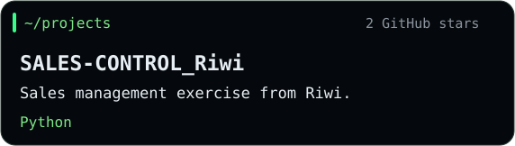

# Stevel Iglesias

<picture>
  <source media="(max-width: 600px)" srcset="./assets/generated/hero-mobile.svg">
  
</picture>

I’m training in software analysis and development at SENA and building full-stack projects at Riwi. I’m interested in defensive cybersecurity, AI, automation, software architecture and cloud computing.

## GitHub activity

## Technologies

Supabase and Postman are also part of my learning toolkit.

## Featured projects

<!-- projects:start -->

<!-- projects:end -->

## Contact

[Email](mailto:steveniglesias@gmail.com)
